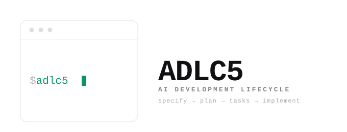

<picture>
  <source media="(prefers-color-scheme: dark)" srcset="assets/brand/logo-dark.svg">
  <source media="(prefers-color-scheme: light)" srcset="assets/brand/logo-light.svg">
  
</picture>

**Public preview.** ADLC5 has tested workflow contracts; comparative coding-quality
and outside-contributor qualification are still pending.

**ADLC5** gives AI coding tools a repeatable delivery workflow: **Specify → Plan →
Tasks → Implement**, connected by a fifth pillar: **Intelligence**. Intelligence
gathers repository knowledge, assembles focused context, and grounds progression
in current evidence. Agent skills handle judgment; one deterministic kernel owns
progression and checks. It aims for repeatable acceptance and failure handling,
not identical generated code.

Read [why an AI coding tool needs a delivery workflow](https://medium.com/@abishek.y/your-ai-coding-tool-needs-a-delivery-workflow-9919b0b58bb4).

## Quickstart

Required: Git, Bash, Python 3.10+, jq, and a supported agent host for AI delivery.
Consumer checks and kernel tests do not require an AI subscription.

```bash
git clone https://github.com/dango-tech/adlc5.git
cd adlc5
cp config.example.yaml config.yaml
./scripts/install.sh --platform codex  # classic skills install; or claude|cursor|all
./scripts/verify-install.sh --platform codex
```

To build and register the host-native **Codex, Claude Code, and Cursor plugins**, see
[Build and install the ADLC5 agent plugins](docs/agent-plugins.md). Each plugin bundles
the shared framework with host-specific metadata; the local package builder creates all
three packages from this checkout and includes registration and public marketplace
submission steps for each host.

**Experimental supervised runner:** configure per-host tiers with
`./scripts/adlc5 setup models --host HOST`, then run
`./scripts/adlc5 run --feature FEATURE --host HOST --workspace PATH`. Codex and
Cursor use confined modes, Claude Code uses its project command allowlist, and
Hermes is attended unless it is inside a user-declared, runtime-detected
container. Comparative cost and quality benchmarks remain pending; see
[runner modes and limits](docs/running.md).

In your application repository:

```bash
/path/to/adlc5/scripts/init-workspace.sh --project .
/path/to/adlc5/scripts/init-feature.sh --feature my-feature --interaction hitl
```

**Plugin users:** build/install the package for your host, then invoke the `adlc5-setup`
skill in your consumer repository. See [host plugin instructions](docs/agent-plugins.md).

Then invoke **`@adlc5 for my-feature`**. Use the framework in consumer repositories;
this repository distributes the framework and its portable `dogfood/` example.
See [installation](shared/docs/INSTALL.md) for other hosts and upgrades.

## Start with an existing repository (brownfield)

Run `init-workspace.sh --project .` in your existing application repository before
the first feature. It preserves existing constitution files, creates missing
drafts under `.agents/` and an ADR area under `docs/adr/`, and builds a local,
gitignored `.agent-cache/`. Review the architecture, boundaries, and commands in
`.agents/`, then validate them with:

```bash
/path/to/adlc5/scripts/adlc5 repo-spec validate --workspace .
/path/to/adlc5/scripts/adlc5 repo-index check --workspace .
```

The codebase is **indexed into JSON**, rather than copied into JSON: `manifest.json`,
`repo-index.json`, `module-map.json`, `symbols.json`, `dependency-graph.json`, and
`test-map.json` record the snapshot, file/module structure, supported symbols and
imports, and test locations/matches. The scan covers eligible source files and
workspace manifests across the repository, excluding generated/dependency folders,
symlinks, and recognized secret files. Extraction varies by language; this is
structural context, not a complete semantic model. Agents query relevant records,
then read source to resolve remaining questions.

Feature initialization refreshes the index; after other edits, use
`adlc5 repo-index refresh --workspace .` when the check reports it stale.
Commit reviewed `.agents/` files and ADRs; leave `.agent-cache/` ignored.
For optional team-shared codebase knowledge, add `--with-project-wiki` and review
ingest drafts before promotion. Feature initialization also bootstraps the wiki
when the brownfield repository profile warrants it. See
[repository context](core/guides/repository-context.md) and the
[project wiki workflow](shared/docs/project-wiki.md).

## Four stages, proportionate depth

| Stage | Useful output |
|---|---|
| Specify | Expected behavior, constraints, acceptance, explicit risk assessment |
| Plan | Existing flow to reuse, intended change, boundaries and decisions |
| Tasks | Bounded work units and checkable specs when decomposition helps |
| Implement | Patch, runnable checks, diff review and current completion evidence |

Tiny work keeps decisions in one `change.md`. Standard work keeps a brief
`design/plan.md`; high-risk work retains detailed design, independent critique,
QA and human approval. Knowledge-base and craftsmanship material are pulled in
when a concrete problem needs them.

## Intelligence — the fifth pillar

ADLC5 gathers repository knowledge, gives agents relevant context, and uses
current evidence to guide delivery. Its distinction is the connection across the
lifecycle: repository maps inform planning, reviewed guidance constrains tasks,
focused context packs equip agents, and evidence checks govern progression.

- **Understand:** generate maps of modules, symbols, import dependencies, and tests.
- **Constrain:** retain reviewed architecture, boundaries, and runnable commands.
- **Equip:** assemble bounded story context from requirements and repository guidance.
- **Refresh and verify:** check map freshness and require current completion evidence.

Models supply reasoning; ADLC5 supplies structured knowledge, context, and checks.
Generated maps remain navigation aids; source and reviewed guidance are authoritative.
SOUL is the supporting reasoning discipline across all four stages.
[Repository context and limits](core/guides/repository-context.md) explains the
mechanics. Better code, fewer errors, or lower token costs require comparative measurements.

## ADLC5 Pulse

Use Pulse for an on-demand view of a feature's stage, recorded checks/review, local
gate observation, known usage subtotal, and suggested next action. It reuses the
existing ADLC5 state and evidence; it does not run your checks or continuously
monitor the repository.

```bash
./scripts/adlc5 pulse snapshot --workspace .
./scripts/adlc5 pulse board --workspace .
./scripts/adlc5 pulse handoff --workspace . --feature my-feature
```

The offline board and cached band are generated when requested. Claude Code also
shows an interactive Pulse band above the prompt; Codex and Cursor use the shared
skill, read-only MCP snapshot, and CLI. Evidence means current at capture only;
missing usage stays unknown. A local gate pass does not mean remote CI, human
approval, deployment, or production health. See the [Pulse guide](docs/pulse.md)
for host support and qualification boundaries.

## What completion establishes

`adlc5 transition TARGET` validates the next step and its required gates.
`adlc5 evidence check` runs consumer-declared commands; review and approval records
are bound to the patch and acceptance/configuration inputs. Relevant edits make
previous evidence stale. Generic `state set` is for metadata, not completion.

`pr-ready` establishes that the selected profile's required checks and review have
passed for current inputs. It does not establish deployment, public availability,
legal clearance, or defect-free production operation. Local records are writable;
this is procedural enforcement, not authentication against a malicious local actor.
See [completion commands and limits](docs/evidence-completion.md).

## Try a real consumer task

```bash
python3 dogfood/consumer/regression.py
python3 scripts/evaluation/run-case.py prepare --case tiny-label \
  --arm candidate --host codex --model YOUR_ACTUAL_MODEL \
  --directory /tmp/adlc5-tiny-label-candidate-1
```

Open the generated `HANDOFF.md` in a fresh host session. The six-case fixture has
independent frozen acceptance tests and a collector that reports missing observations
honestly. See [consumer instructions](dogfood/consumer/README.md) and the
[evaluation contract](docs/evaluation.md). Automated fixture tests are not live
comparative quality results; the pilot and outside-contributor trial remain pending.

## Host support

The contract-test CI matrix covers Ubuntu and macOS; disposable installation smoke
covers Claude skill links and kernel verification. See [cross-platform details](shared/docs/CROSS-PLATFORM.md)
and the [host plugin build/install guide](docs/agent-plugins.md) for package creation,
registration, and host-specific qualification boundaries.
Live delivery/resume qualification must be recorded per host before broader claims.
See [distribution contents](docs/distribution.md) for archive exclusions and publication checks.

## Contribute

```bash
/bin/bash scripts/tests/run-all.sh
python3 scripts/tests/test-portable-install.py
```

Start with a reproducible problem and a focused fix. A new rule, gate or skill should
show the failure it prevents. [CONTRIBUTING.md](CONTRIBUTING.md) names the checks and
consumer scenario expected for each contribution; [GOVERNANCE.md](GOVERNANCE.md)
describes larger changes.

Further reference: [kernel](docs/ADLC5-kernel.md), [skill map](shared/docs/SKILL-MAP.md),
[repository context](core/guides/repository-context.md), [on-demand KB](shared/docs/knowledge-base/README.md),
[current technology sources](core/guides/current-information.md), [license](LICENSE).

Framework version: [core/VERSION](core/VERSION). Persisted state retains schema `3.0`.

## Documentation website

The [ADLC5 developer site](https://dango-tech.github.io/adlc5/) in `website/docs/`
covers installation, a first-feature walkthrough, lifecycle, troubleshooting,
releases, Intelligence, and reference.
The [GitHub Wiki overview](https://github.com/dango-tech/adlc5/wiki/ADLC5-Overview)
provides a project-level introduction. For a local preview:

```bash
python3 -m venv .venv-docs
. .venv-docs/bin/activate
python -m pip install -r requirements-docs.txt
python -m mkdocs serve
```

See the [site maintenance and Vercel deployment guide](docs/documentation-site.md)
for builds, validation, and automatic private previews from `main`.
