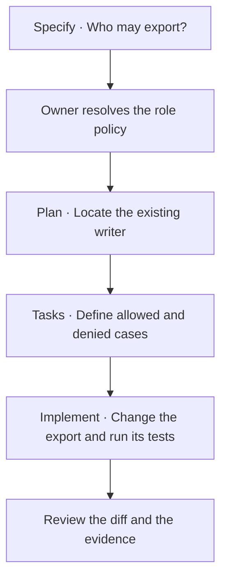
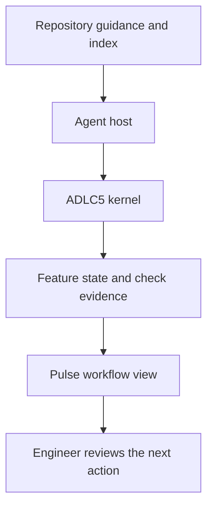

# See what your coding agent is building

A feature can span several agent sessions. ADLC5 keeps the requirement, implementation progress, and verification evidence in your project so you can find the decision or check that needs attention.

[Walk through a feature](https://www.adlc5.dev/walkthrough/) · [Choose your agent](https://www.adlc5.dev/installation/) · [Explore Pulse](https://www.adlc5.dev/pulse/)

## From a question to a test

Imagine a team asking for a CSV export. The codebase can tell the agent which CSV writer to reuse. The product owner can tell it which roles should be allowed to export. Keeping those answers together gives the reviewer a specific behavior to check.

## Where the evidence lives

Your host runs the agent. ADLC5's kernel checks whether the feature can advance. The repository holds the reviewed architecture, feature state, and evidence. Pulse reads those records to show what happened and what needs attention. Trace the connections in the [architecture guide](https://www.adlc5.dev/architecture/). See [Intelligence](https://www.adlc5.dev/intelligence/) for the repository layout.

## Evaluate the public preview

Start in a disposable consumer repository. Follow the instructions for your host, open the workflow in Pulse, and inspect the evidence behind a check. Teams evaluating adoption can inspect [host qualification](https://www.adlc5.dev/host-qualification-cycles/) and the [benchmark program](https://www.adlc5.dev/benchmarks/). For the complete project overview, visit [ADLC5 Overview](ADLC5-Overview).
