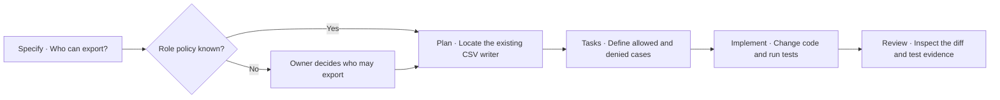
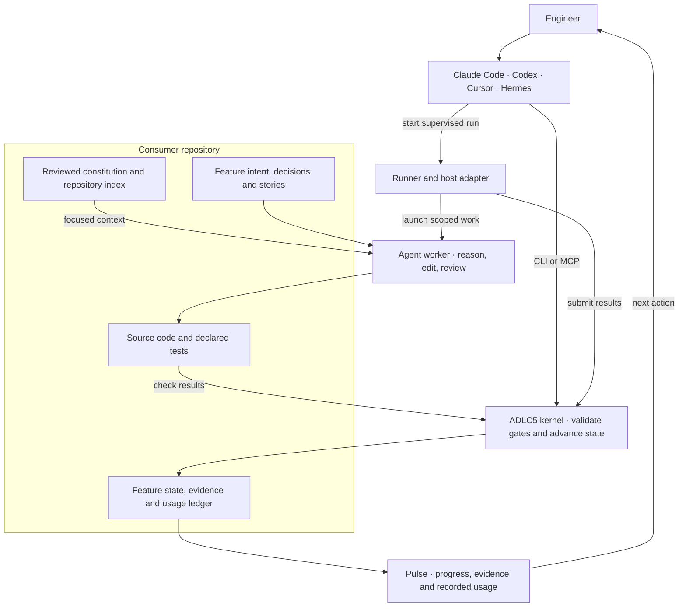

# ADLC5 golden state implementation plan

**Status:** Revised delivery plan. Baseline is GitHub `main` at `e79b73a` (5.3.2). The 5.4.0 bump follows release qualification.

## Outcome

An engineer can describe a feature, resolve material questions, review the repository context and plan, and reach an independently reviewed PR with green required consumer CI within the declared delivery budget. If the run stops, the next owner can see the exact blocker, the earliest retry, the evidence that still applies, and what the run consumed. A fresh session resumes from that evidence.

Keep Specify → Plan → Tasks → Implement and the existing `tiny`, `standard`, and `high_risk` profiles. The existing kernel owns decisions, transitions, and evidence. Host adapters translate native capabilities. Pulse displays the same records that drive the runner. Use deterministic tooling for Git, indexing, validation, tests, and measurement. Route judgment by task and risk.

The next release should fix the observed waste before expanding the framework. In the observed consumer run, Codex attempted the opening Git isolation gate three times in 99 seconds. It recorded 580,296 tokens, including 439,296 cache reads, and never advanced. All attempts used `host default`, and the third escalated to the reasoning tier. The recorded failure was generic. The first regression should reproduce the repeated-failure behavior with a synthetic Git gate failure and an executor spy.

The [existing golden harness](golden-harness-implementation.md) already supplies intent readiness, scope and acceptance anchors, and evidence freshness. Its [qualification protocol](golden-harness-qualification.md) remains the reference for the broader comparative campaign. This plan extends that work through execution, operations, and release qualification.

## Delivery sequence

Each row is a reviewable increment. File paths are relative to the distribution root. Exercise delivery flows in disposable consumer repos or `dogfood/`.

| Increment | Scope | Acceptance |
| --- | --- | --- |
| **0. Freeze the baseline** | Extend the existing evaluator and test fixtures. Pin source, cases, oracles, budgets, hosts, and models. | Reproduce retry waste locally and verify the test detects attempted worker launches. Freeze comparable external quality evidence before changing the runner. |
| **1. Deterministic bootstrap** | Extract shared bootstrap diagnostics from existing Git, state, and gate behavior. Route runner and in-agent entry points through the same result. | Valid bootstrap uses zero model calls. A blocked workspace produces one actionable diagnostic and zero worker launches. |
| **1A. Early paired brownfield trial** | Run the bootstrap-only candidate on Codex and Claude using fresh copies of the same pinned consumer repo. | Capture an actual PR outcome or an evidence-backed stop per host. Record elapsed time, calls, decisions, failure and recovery before selecting further redesign work. |
| **2. Bounded execution and resume** | Use the existing runner journal, worker envelopes, questions, and model configuration. Add typed stops, task-sized briefs, and enforceable launch limits. | Repeated unchanged blockers cannot escalate. Interruptions preserve accepted work. With the old process gone, exactly one eligible continuation starts and current approvals carry forward. |
| **3. Engineering evidence and brownfield context** | Improve the constitution and index workflow, scoped planning, and profile-specific tests/evidence. | Existing repositories retain their commands and standards. A bounded feature can use targeted context and produce traceable acceptance and CI evidence. |
| **4. Guided Pulse** | Project decisions, blockers, attempts, and evidence from the existing kernel records. Ship deep links and host-native action handoffs. | An engineer new to ADLC5 can resolve the one consequential product decision, see its impact and resulting acceptance test, and recover a stopped run. |
| **5. Host qualification** | Exercise install, first delivery, interruption, resume, and uninstall on native app and CLI surfaces. | Every end-to-end claim has a versioned signed-in receipt for an actual disposable PR, green required CI on its exact head, and independent review. |
| **6. Release qualification** | Run the frozen comparison, check upgrade/rollback, verify signed-off artifacts, and publish scoped results. | The release satisfies the gates below. Claims match measured data, supported surfaces, and published package provenance. |

Run increment 1A with bootstrap and only the instrumentation needed to measure it. Freeze the same task, revisions, time budget, tools, and human availability for the two hosts. Keep the existing bounded-runner, context, budget, Pulse, and packaging PRs available for review. Use the paired trial to decide which changes advance, which need correction, and which can wait. Local contract tests and package smoke checks remain supporting evidence.

## 0. Baseline and fixtures

- Extend `scripts/tests/test-runner-core.py`, `scripts/tests/test-runner-hosts.py`, and the existing evaluation harness. Include an unchanged Git-gate failure, a valid Git setup, a workspace outside the allowed roots, a stale condition repaired without restarting the feature, and mixed worker failures.
- Freeze a tiny change, a representative standard brownfield feature, a greenfield consumer, and a high-risk feature with a real approval and an interruption. Keep the existing six-case and extended case banks intact. Add or pin representative Git revisions where those banks need real-repository coverage.
- Record start/end events, worker launches, observed usage, reruns, user interventions, and external acceptance for the baseline. Distinguish replayed deterministic fixtures from signed-in delivery. Preserve failed runs and missing telemetry.

## 1. Deterministic bootstrap and actionable blockers

- Reuse feature initialization, gate checks, and workspace binding in `scripts/init-feature.sh`, `scripts/runner/run.py`, and the kernel. Use one canonical absolute workspace, branch, starting commit, and feature identity. Validate relevant write boundaries and actual Git metadata placement, declared commands, and available host capabilities. Use safe scoped checks for filesystem permissions and paths.
- Return a machine-readable outcome with the attempted step, failed condition, offending path or command identifier, evidence, and safe next action. Persist a sanitized record so CLI, MCP, and Pulse can refer to the same blocker. Surface workspace permission and product decisions through their existing distinct paths.
- Run Git isolation as kernel work. Verify an already-correct worktree and advance through the normal gate. For a conflicting or unwritable checkout, preserve existing work and give the engineer a specific way to rebind or regain access.

**Required tests:** no worker launch for valid bootstrap or a deterministic bootstrap blocker. Cover current and existing feature branches, linked worktrees, stale bindings, symlink/sandbox boundaries, unavailable Git metadata, dirty state, and branch contention. Rerunning after a repair advances once without duplicating state.

## 1A. Early paired brownfield trial

The [three-story dogfood fixture](../dogfood/brownfield/README.md) provides the pinned input, seeded failing check, stakeholder script, and external compatibility oracle for the first diagnostic. Use a pinned real consumer repository for broader claims about brownfield delivery.

- Pin one representative existing consumer repository and one multistory change. Use a private or otherwise approved disposable destination for each actual PR. Set identical starting commits, requirements, acceptance oracles outside the worker's writable tree, consumer required CI, stakeholder script, and independent review rubric. Record host version and model. Use fresh sessions for both runs.
- Seed a real compatibility, migration, concurrency, or scale obligation. A case can, for example, extend an existing delivery service while preserving its public response and persisted records on upgrade. Freeze the external checks for both old and new behavior. Include facts the agent should discover from the repo and one business choice that requires the stakeholder.
- Give each host the same scripted decision only when requested. Fail one required check, interrupt after a recorded checkpoint, then recover with the original process gone. Compare where time and model calls accumulate and whether a previously valid answer or narrow permission is requested again. Record owner, restart method, early resume rejection where applicable, and the number of new continuations.
- Open the actual disposable PR through the allowed handoff. Capture its URL and head SHA, required CI results on that SHA, independent review of that SHA, external acceptance, and whether those arrived by the deadline. Record incomplete runs and their blocker. Two runs are diagnostic evidence. Repeat a frozen campaign before claiming an acceptance rate or savings.
- Review the two traces before expanding runner scope. At the existing PRs, retain deterministic bootstrap and package fixes, verify whether bounded execution and context/cost controls address measured waste, and verify that Pulse and focused repository context help the engineer complete the trial.

## 2. Cost control, recovery, and host adapters

### Execution and context

- Use `scripts/runner/run.py`, `hosts.py`, and the existing pack generator. Bind one worker to one stage step or story. Build one shared evidence section and a bounded story-specific section. Select the current phase guidance. Preserve acceptance criteria, constraints, and applicable failure behavior when trimming optional detail.
- Measure the complete assembled brief before launch. Enforce its configured cap. If required material exceeds the cap, split the work or return a structured blocker. Record estimated brief size and actual observed usage separately. Benchmark cold and warm context paths.
- Extend the existing policy configuration with per-step and per-feature limits for time, attempts, and observed usage. Reserve budget before a worker launch and reconcile after exit. Document that feature-level accounting can lag. Enforce provider-side token or dollar limits where the host supports them. With delayed or absent accounting, use a conservative launch bound and a worker timeout. Require a capable adapter and pricing/accounting path for any policy that promises a hard dollar cap.
- Validate routing before launch. A strict cost policy requires a supported model resolved for each applicable tier. Record requested tier/model and observed model separately. Route ordinary edits and test authoring to a configured execution model. Run existing test, lint, build, and coverage commands directly. Route ambiguity, architecture, high-risk review, and novel diagnosis to the approved reasoning tier.

### Retry and recovery

- Classify outcomes as passed, missing input, missing permission, quota or transient host failure, test/review failure, invalid output, and recovery required. Retry a confirmed transient failure only within policy. Repeated failures with the same blocker fingerprint require changed input or a recorded decision. Model escalation requires a specific reasoning gap and remaining budget. Persist a resumable stop with the feature and step, blocker, owner role, resume mode, and earliest retry time when supplied by the host. Where the provider gives no retry time, show it as unavailable and give the named operator a resume action. A provider quota wait must be distinguished from human input, remote CI, and worker execution.
- Default to operator-owned resume on interactive app/IDE and attended CLI surfaces. Show an exact resume action and the existing evidence or permission request it depends on. On supervised CLI surfaces, automatic resume is a separate, explicitly enabled capability with the existing workspace lock, scheduled earliest retry, attempt/time bounds, and a durable claim. Assign the operator if automated resume is unavailable or its allowance expires. Keep the surface capability receipt in the qualification matrix.
- Reuse the journal and workspace lock. Make result ingestion, evidence, and usage replay safe after a restart. Bind receipts to the actual commit or diff, intent, policy, and applicable commands. Store the next action before exit. Reuse prior decisions and verified artifacts when their dependencies still match.
- Preserve user, concurrent, and unclassified edits during recovery. Constrain cleanup to recorded attempt-owned changes in the correct worktree. When ownership is uncertain, preserve the working tree and surface a recovery blocker. Keep existing state and archived usage readable with additive fields and explicit unknown values.

**Required tests:** no retry on an unchanged mechanical blocker. Fault-inject exits after launch, result validation, evidence ingestion, usage recording, and before transition. Terminate the original process and issue competing resume attempts. Verify one continuation, no duplicate transition, no restart before a known retry time, and reuse of approvals while their intent and permission scope remain current. Confirm a changed requirement invalidates affected evidence and prompts for the new decision once. Cover quota, timeout, stale lock, budget exhaustion, interrupted writes, and preservation of concurrent edits. Check host fallback and partial-accounting behavior.

## 3. Engineering standards and repository onboarding

- Guide greenfield teams through intended architecture, ownership, boundaries, commands, and initial test/CI setup. For brownfield, discover existing repo guidance and use its current architecture and commands. Offer ADLC5 defaults where the repository lacks a standard. Write generated suggestions as drafts for review in Git.
- Extend `repo-spec` and `repo-index` only where the fixture identifies a gap. Plan from the tracked constitution and a fresh map of affected modules and tests. Measure full refresh, targeted retrieval, and re-indexing at a fixed brownfield revision. Add incremental indexing only if baseline refresh cost justifies it. Keep any future OpenViking mirror optional and derived from the same reviewed sources.
- Map intent to stories, acceptance anchors, files and canonical checks before build. Require applicable compatibility, state migration, idempotence, recovery, and performance evidence. Use design patterns where the change has a concrete design problem. Review the diff for boundaries, duplication, complexity, and reuse. Scope check requirements to the repo and risk profile.
- Reuse evidence commands and the existing PR-ready gate. Record applicable unit, integration, and end-to-end checks plus configured coverage thresholds. Track local checks, remote CI, review approval, deploy clearance, and production observation as distinct milestones.

**Required tests:** run greenfield and brownfield fixtures. Preserve existing constitution files and canonical commands. Demonstrate the compact tiny path, a standard multistory change, and a high-risk flow with independent review and genuine approval. Reject stale evidence, missing applicable checks, and invalid acceptance mappings. Validate any index change against fresh full-build output.

## 4. Pulse as the engineer's working view

- Extend the existing Pulse projection and schema. On the workflow page, show the feature ask, readiness and unresolved decisions, repo mode and applicable standards, plan/story progress, current blocker, and links to evidence. Place the actionable blocker or decision ahead of the full lifecycle detail.
- Provide **Review decision**, **Review evidence**, and **Resume** handoffs through the host or exact kernel command. Start with the existing read-only board and MCP snapshot. A host integration that submits a decision must use the existing `answer` path and preserve intent, approval scope, and stale-decision validation.
- Attribute attempt data using existing run, node, session, story, and attempt identities. Display requested and observed models, fresh and cached token buckets, known cost and accounting source, elapsed and wait time, test coverage from its report, and retry/failure reason. Show unavailable measurements and the attributable subtotal. Deduplicate hook and runner observations where they share stable identity. Never sum independently overlapping time as elapsed or average coverage percentages with unequal denominators.
- Roll up feature → stage → story/step → attempt, and feature → repository. Show delivery outcome rate with a denominator and observation window. Show attempts separately to expose rework. Include failed and interrupted spend. Make archives and worktrees navigable via stable links.

**Required tests:** fixture with one feature across two hosts, a failed attempt, an interruption, a duplicate event, and partial usage. Verify totals and time math, cache freshness, archive fidelity, safe rendering, permission boundaries, and direct links. Conduct a live decision trial with an engineer new to ADLC5. The agent must find the repo-answerable facts, ask the one consequential product question, explain affected requirements and stories, and link the resulting external acceptance test. Restart after the answer and verify reuse. Record unnecessary questions, missed consequential questions, lost answers, and repeated setup using the [qualification rubric](golden-harness-qualification.md).

## 5. Qualify each host and surface

Use [the existing host matrix](host-qualification-cycles.md). For each supported combination record the artifact digest, host/version, OS, entry point, permission mode, requested and observed models, accounting capability, and evidence links. Use a repo-scoped opt-out and verify the project can still use its native agent workflow.

| Host | CLI qualification | App or IDE qualification |
| --- | --- | --- |
| Codex | Structured worker results, workspace permissions, model resolution, process restart and usage records | Clean local plugin install, MCP in the correct workspace, start a feature, handle a decision, open Pulse and resume |
| Claude Code | Headless output, declared command permission, denial recovery, intended routing and transcript usage | Clean Code-tab install, Pulse card and navigation, start/resolve/resume and usable evidence links |
| Cursor | Headless output, sandbox decision, scoped write and fresh-session resume | Clean IDE install and trust prompts, skills/MCP and Pulse handoff, with usage checked under the advertised account capability |
| Hermes | Attended delivery and restart through the CLI. Qualify unattended independently within its container boundary before advertising it | Verify the attached profile/backend, shared state and Pulse handoff, then start/resolve/resume from Desktop |

For each host and surface advertised for end-to-end delivery, prove one disposable actual PR following normal entry points from clean setup. Required consumer CI, external acceptance, and an independent review must all apply to the exact PR head. Record the actual PR and latest required evidence timestamps. Recover an interruption with one continuation and show stale evidence rejection after changed intent. Test the explicit automatic or operator-owned resume path for that surface. Package installation, local PR readiness, green required CI, independent approval, human merge, and deployment each have their own receipt. Keep merge and deployment under explicit human approval. Advertise a narrower capability when a surface has only package, local, or attended evidence.

## 6. Release and benchmark gates

1. **Correctness and continuity.** Zero bypasses of approval, acceptance anchors, workspace ownership, or current-evidence checks in the release suite. Zero duplicate progression or lost approved answers in restart tests. Pass the existing required local and remote CI checks, plus profile-specific acceptance and host qualification.
2. **Practical adoption.** On each claimed app surface, an engineer can find the feature ask, current blocker, and next action, then resume from the correct workspace. Include at least one engineer who did not build the harness in onboarding and recovery trials. Record task completion, intervention, and where discovery failed.
3. **Measured overhead and economics.** Start on Codex and Claude with matched direct-agent, frozen 5.3.2, candidate same-model, and candidate tiered arms. Keep host permissions, starting revisions, external quality oracles, review rubric, user availability, and budgets fixed. Preregister repetitions and accounting sources. Run the corrected repeatable protocol on Cursor and Hermes to support claims about those hosts. Reserve the broader Spec Kit campaign for a scoped comparison, using the existing extended protocol.
4. **Comparison rules.** Report external quality and release readiness separately. Report the deadline-based delivery rate below, the elapsed and wait time breakdown, and human interventions. Report comparable spend per accepted feature separately, including all failed and late-run spend in the numerator. Show failed and quota-paused runs and paid API cost versus subscription usage separately. Compare matched cases and report uncertainty. Publish a savings claim only for the measured cohort that meets the existing quality and accounting requirements.
5. **Artifact and recovery verification.** Rebuild the four packages from the release commit, verify manifests and digests, and install the actual candidate artifacts on claimed surfaces. Prove upgrade from 5.3.2 on an active feature and read compatibility for archives. Document a tested rollback or forward-recovery path for any record migration. Keep install, package publication, and deployment receipts distinct.

### Primary delivery measure

**Features accepted within the declared wall-clock budget ÷ features started.** Start the clock when the host receives the frozen task. Include every started run in the denominator, including blocked, abandoned, interrupted, quota-paused, failed, and late runs. Exclude scheduled runs that never received the task and report them separately. Acceptance time is the latest timestamp for passing external acceptance and regression checks, passing required consumer CI, and independent approval of the actual PR's exact head. An accepted result outside the budget remains a late result. Allow completion exactly at the deadline. Missing or contradictory evidence stays unverified and does not enter the numerator.

| Feature class | Proposed elapsed budget | Proposed minimum on-time acceptance |
| --- | --- | --- |
| Tiny | 60 minutes | 90% |
| Standard multistory | 4 hours | 80% |
| High risk | 24 hours | 80% |

These are starting thresholds to freeze with workload count, repetitions, reviewer availability, and start/deadline semantics before the confirmatory campaign. Apply the absolute floor by class even if the frozen baseline performs poorly. The early two-run trial diagnoses the workflow and informs the preregistration. Track no critical quality regression and no approval, acceptance-anchor, or stale-evidence bypass as separate gates. Report sample size and uncertainty.

Report active, human-wait, quota-wait, CI-wait, and unclassified time. Use exclusive elapsed intervals when reconstructing a timeline and flag gaps or overlapping measurements. Include queue time before deadline acceptance after the task is released. Count billed or otherwise comparable campaign spend across every started run when reporting cost per accepted feature. Publish the count of accepted outcomes used in that denominator, the accounting coverage, and the spend on failed and late runs. Keep missing cost unavailable and never let a cost improvement compensate for a delivery miss.

Promote 5.4.0 only after the required PRs and CI, signed-in host qualification, deadline-based trial results, newcomer decision trial, and exact release artifact/upgrade recovery receipts are attached. A reviewed, green consumer PR completes the advertised delivery workflow. Merge and deploy approvals remain separate.

## 7. Website and Wiki launch plan

**Audience and destination.** The first-time engineer wants to know what happens after handing a feature to an agent. The engineering lead wants to inspect the checks, host limits, and cost evidence before trying it with a team. On November 18, 2026, the live ADLC5 homepage opened as “ADLC5 developer guide,” and the GitHub Wiki root opened on its page list. The verified product destination is [adlc5.dev](https://www.adlc5.dev/). The requested addna.dev domain did not resolve during inspection. If AdDNA is an intentional second destination, use a short engineering case study on its confirmed site, linking to the ADLC5 walkthrough. Establish the domain owner, audience, permission to identify the consumer, and publishable results before scheduling that placement.

### What the visitor sees

**Proposed homepage headline:** “See what your coding agent is building.” Follow with “Follow a feature from the original request through planning, code changes, tests, and review. Open Pulse to see progress and what needs your attention.” Put **Walk through a feature** beside **Choose your agent**. Preserve the existing brand and public-preview label. Show a legible crop of real Pulse output above the fold, with a caption identifying the version and demo repository. Follow with the four-stage graphic, one engineering example, and a host picker linking directly to the matching setup instructions and verified capability row.

Use one disposable example throughout the site and Wiki: a team asks for a CSV export. The repository reveals the existing CSV writer and test command. The product owner decides who may export. The implementation reuses the writer, and a denied-role test supplies review evidence. Label this example as illustrative until a recorded run supplies the artifacts. Use a real screen capture for product UI and an illustration for conceptual flows.

### Graphic 1 · Follow a feature

Homepage illustration, with a vertical reading order on narrow screens. The decision branch shows where an engineer contributes. Clicking a stage should open the corresponding point in the walkthrough.

### Graphic 2 · How ADLC5 works inside your repo

Place this on Wiki Home and the website architecture guide. Draw a visible boundary around the consumer repository. The engineer should be able to point to the component that decides whether work advances and the files that survive a new chat.

### Graphic 3 · A decision in Pulse

Produce a three-frame annotated strip from the disposable export example. Frame one shows the original ask and current stage. Frame two highlights the unresolved role decision and identifies the owner. Frame three pairs the resumed story with the exact denied-role test and its result. On mobile stack the frames in order. Each caption should explain what changed, with a link to the matching walkthrough step. Capture the actual host action and label its surface. Use mockups only in design review. Publish the resolved-decision strip once the guided decision trial demonstrates the sequence.

### Delivery, owners, and checks

| Order | Deliverable and owner | Acceptance |
| --- | --- | --- |
| 1. Establish entry points | Docs maintainer creates Wiki Home and sidebar linking Overview, Pulse, Walkthrough, Host support, and release evidence. Preserve existing page URLs. Revise the MkDocs landing page in `website/docs/index.md`; retain installation, reference, and support routes. | A first-time visitor can reach the walkthrough or their host instructions from either landing page in two selections. Each installation command and compatibility claim has one maintained source. |
| 2. Build the visual walkthrough | Designer and engineer produce the two diagrams above and annotated Pulse frames using existing brand colors and typography. Keep editable sources together and supply static exports plus text equivalents for both surfaces. | Verify legibility on a phone and desktop, light/dark contrast, keyboard navigation, meaningful alt text, and clear evidence labels. Scrub private paths, prompts, names, and credentials from captures. |
| 3. Connect release evidence | Release owner adds a dated case card after the paired brownfield trial. Link the consumer PR, CI result, host/version, elapsed time, and accounting coverage where publishable. For an AdDNA placement, explain one documented engineering decision and its outcome for that audience. | Each public claim traces to a release or trial receipt. Proposed savings stay in the roadmap until supported by matched runs. Unsupported surfaces show their specific qualification status. |
| 4. Validate and publish | Docs owner runs the repo docs build, tests Wiki rendering, and checks links, redirects, canonical URLs, social preview, sitemap, and phone layout on preview. Publish website and Wiki revisions, then recheck the actual public journeys. | A newcomer can explain the workflow, find the correct host setup, and locate the evidence behind a claim unaided. Record failed steps and revise the entry points. |

**Measure adoption.** Before launch, record the current time and success rate for finding host setup and interpreting a Pulse blocker in a newcomer task. Repeat the same tasks after launch. Use available aggregate page or link counts for walkthrough visits and host setup clicks. Record verified first-run completion separately in opt-in trials. Preserve unknowns where collection is unavailable. Refresh host rows, screenshots, and evidence links as part of each release.
