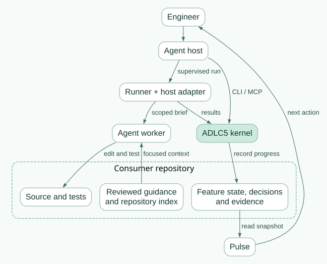

# How ADLC5 works inside your repo

The engineer works through an agent host. A runner and host adapter launch scoped agent work; the worker reasons, edits and reviews. The ADLC5 kernel validates gates and advances feature state. The consumer repository holds the project's inputs and evidence across sessions.

Open the diagram at full size to trace its connections.

The runner submits results to the kernel; test results are evidence for its checks. The kernel records feature state and evidence, which Pulse reads on demand. The host and worker do not replace the kernel's progression checks. Repository indexes are derived context, while reviewed guidance and feature artifacts carry the team's intent. See [Intelligence](intelligence.md), [Pulse](pulse.md), and the [kernel reference](https://github.com/dango-tech/adlc5/blob/main/docs/ADLC5-kernel.md).
