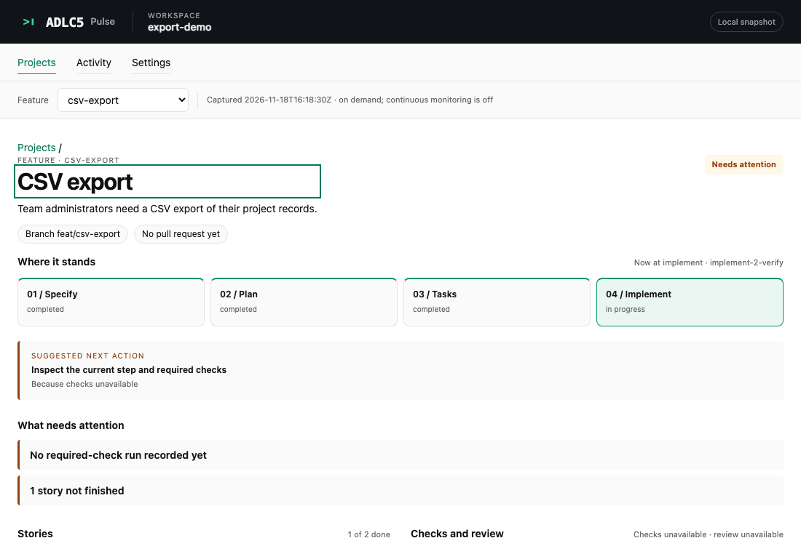

# See what your coding agent is building

**Public preview.** Workflow contracts are tested; comparative coding-quality results and outside-contributor qualification remain pending.

Follow a feature from the original request through planning, code changes, tests, and review. Open Pulse to see progress and what needs your attention.

[Walk through a feature](walkthrough.md){ .md-button .md-button--primary }
[Choose your agent](#choose-your-agent){ .md-button }

*Pulse in ADLC5 5.3.2 · illustrative CSV export fixture. The screenshot uses synthetic data and is not evidence of a completed run.*

**Illustrative example · CSV export**

A team requests an export. The owner decides who can use it; the agent finds an existing CSV writer, defines allowed and denied cases, and produces changes and test evidence for review.

This is a conceptual example, not a claim about a completed run. [See Pulse](pulse.md) for its actual surfaces and evidence limits.

## Follow a feature

The stages link to the walkthrough. An unresolved policy goes to the owner before planning continues.

<a href="walkthrough/#specify"><strong>1 · Specify</strong>Who can export?</a>
<a href="walkthrough/#decision"><strong>Owner decision</strong>Resolve an unknown role policy</a>
<a href="walkthrough/#plan"><strong>2 · Plan</strong>Find the existing CSV writer</a>
<a href="walkthrough/#tasks"><strong>3 · Tasks</strong>Define allowed and denied cases</a>
<a href="walkthrough/#implement"><strong>4 · Implement</strong>Change code and run tests</a>
<a href="walkthrough/#review"><strong>Review</strong>Inspect the diff and evidence</a>

If the role policy is already known, Specify can proceed to Plan. If it is unknown, the owner decides first. Intelligence supplies repository knowledge and focused context across the four stages; the kernel checks progression. [See how the pieces connect](architecture.md).

## Choose your agent

Start with a host package and check its recorded qualification before relying on a particular workflow. Package availability does not imply equal end-to-end qualification.

| Agent | Setup | Evidence |
| --- | --- | --- |
| Codex | [Install a native plugin](installation.md#native-agent-plugins-codex-claude-code-cursor-and-hermes-agent) | [Host qualification](host-qualification-cycles.md) |
| Claude Code | [Install for Claude Code](installation.md#claude-code-plugin-local-package) | [Host qualification](host-qualification-cycles.md) |
| Cursor | [Install a native plugin](installation.md#native-agent-plugins-codex-claude-code-cursor-and-hermes-agent) | [Host qualification](host-qualification-cycles.md) |
| Hermes Agent | [Install a native plugin](installation.md#native-agent-plugins-codex-claude-code-cursor-and-hermes-agent) | [Host qualification](host-qualification-cycles.md) |

[Downloads](downloads.md) · [All installation options](installation.md) · [Quickstart](quickstart.md)

## Evidence before completion

`pr-ready` checks the selected readiness profile against the current work. Deployment, remote CI and live host qualification require separate evidence. Read the [completion limits](lifecycle.md#what-completion-establishes), [benchmarks](benchmarks.md), and [host qualification cycles](host-qualification-cycles.md). Missing usage or cost data is unknown, not zero.

[Reference](reference.md) · [Troubleshooting](support.md) · [GitHub Discussions](https://github.com/dango-tech/adlc5/discussions) · [GitHub Issues](https://github.com/dango-tech/adlc5/issues)
